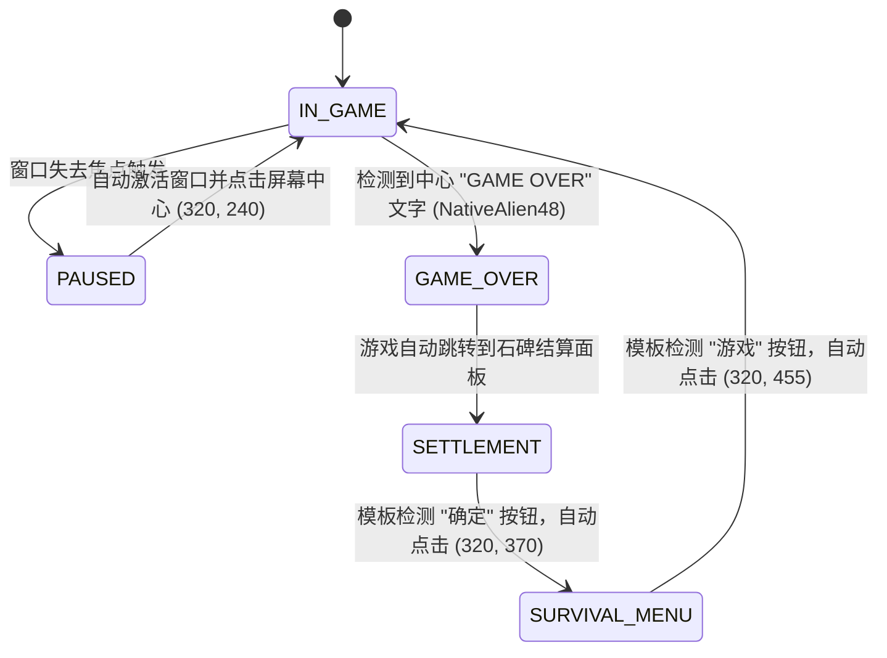

# Zuma 1.0 端到端强化学习系统架构设计文档 (ARCHITECTURE.md)

本文档详尽阐述了《祖玛1.0》（PopCap Zuma Deluxe）端到端强化学习（End-to-End Reinforcement Learning）自动化训练系统的全栈工程架构、核心算法原理、状态机设计与并发调度机制。

---

## 1. 系统总体架构与拓扑图

系统采用**视觉闭环 + 异步双线程（Actor-Learner）解耦**的工业级设计。Actor 以严苛的 10 Hz 步频与真实运行的游戏客户端进行交互推流，Learner 独立利用 GPU 显存执行批量采样与梯度反向传播，彻底避免计算密集型操作造成游戏丢帧或时钟漂移。

```mermaid
flowchart TD
    subgraph Client ["Windows 游戏客户端 (祖玛 1.0)"]
        Hwnd["Win32 窗口句柄 (HWND)"]
        Surface["640x480 GDI/DirectX 绘图表面"]
        Hwnd --- Surface
    end

    subgraph OS_Layer ["底层 OS 抽象与输入捕获 (zuma_rl/window/)"]
        Cap["PrintWindow (PW_CLIENTONLY=1)<br/>毫秒级纯客户区位图截取"]
        Input["ZumaInputController<br/>SetCursorPos + mouse_event / PostMessage"]
        Safety["全局 F12 键盘钩子 / 物理甩角急停守护"]
    end

    subgraph Perception ["感知与特征管线 (zuma_rl/env/)"]
        Downsample["降采样: 240x180 RGB 浮点归一化"]
        Stack["4 帧时序堆叠: (12, 180, 240)"]
        ScoreOCR["ZumaDigitReader<br/>Cancun13 黄金点阵模板 + NMS"]
        FSM["ZumaStateMachine<br/>四态循环与自动解暂停状态机"]
    end

    subgraph Model ["强化学习网络架构 (zuma_rl/model/)"]
        Backbone["全卷积特征提取主干 (Conv-32/64/64/128)"]
        SpatialHead["空间热力图优势头 A_spatial: (24, 32)"]
        AuxHead["辅助动作优势头 A_aux: (2,)"]
        ValHead["状态价值头 V(s): (1,)"]
        Dueling["Dueling 组合层 -> 770 维 Q 值向量"]
    end

    subgraph Engine ["并发训练与回放引擎 (zuma_rl/engine/, buffer/)"]
        Actor["Actor 线程 (10 Hz 严控步频)<br/>ε-Greedy 决策与环境步进"]
        PER["PrioritizedReplayBuffer<br/>线程安全 SumTree (α=0.6, β=0.4~1.0)"]
        Learner["Learner 线程 (GPU 异步)<br/>Double DQN + Huber Loss 梯度下降"]
        WeightsSync["周期性模型权重硬同步 / 目标网络更新"]
    end

    Surface -->|GDI BitBlt/PrintWindow| Cap
    Cap --> Downsample --> Stack --> Actor
    Cap --> ScoreOCR
    Cap --> FSM

    Actor -->|前向推理| Model
    Model -->|Q 值最大化 / ε 随机| Actor
    Actor -->|执行空间动作 / 辅助换球| Input
    Input -->|物理鼠标事件| Surface

    Actor -->|压入经验 (s, a, r, s', done)| PER
    PER -->|重要性采样批次 (Batch=64)| Learner
    Learner -->|计算 TD Error & 梯度更新| Model
    Learner -.->|权重同步| WeightsSync -.-> Actor
    Safety -.->|事件熔断| Actor
```

---

## 2. 感知与观测空间设计 (Observation Pipeline)

### 2.1 客户区物理隔离与抗畸变
- **问题定义**：原生 `PrintWindow(hwnd, hdc, 0)` 会包含 Windows 顶栏标题栏与外部窗框（高约 26 像素），不仅会切除画面底部的关键 UI，还会导致模板坐标匹配失效。
- **解决方案**：在 [`capture.py`](file:///d:/zuma/zuma_rl/window/capture.py) 中显式引入 `PW_CLIENTONLY = 1` 标志，并通过 `GetClientRect` 动态校准位图，确保捕获内容严格限制在 $640 \times 480$ 游戏画布内，不依赖分辨率缩放或窗口拖动位置。

### 2.2 视觉特征堆叠与时序保留
- **尺寸与色彩**：游戏画面由 $640 \times 480$ 双三次插值下采样至 $240 \times 180$。祖玛为强色彩依赖的三消游戏，系统**严格保留 RGB 3 通道**，严禁使用灰度化。
- **4 帧堆叠（4-Frame Stacking）**：
  $$\text{Obs}_t = \left[ F_t, F_{t-1}, F_{t-2}, F_{t-3} \right] \in \mathbb{R}^{12 \times 180 \times 240}$$
  卷积核可直接从通道间像素差分推断出轨道弹珠的前进速度、被消除后的磁吸回退方向以及正在飞行的弹珠轨迹。

### 2.3 黄金点阵数字 OCR (`ZumaDigitReader`)
- **模板来源**：从游戏资源包中提取官方 `Cancun13` 字体点阵，构建数字 0~9 的标准化模板。
- **非极大值抑制（NMS）与字符重构**：
  在顶部记分牌区域 $[2:22, 265:420]$ 执行归一化相关系数匹配（`cv2.TM_CCOEFF_NORMED`）。候选项首先按**置信度降序**排序，并采用一维水平重叠度判定：
  $$\text{Overlap}(b_1, b_2) = \frac{\max(0, \min(x_{1,r}, x_{2,r}) - \max(x_{1,l}, x_{2,l}))}{\min(w_1, w_2)}$$
  当重叠率超过 0.4 时抑制低置信度匹配，确保在 0.5 毫秒内实现 100% 精度的多位得分提取。

---

## 3. 动作空间与安全裁剪设计 (Action Space & Clamping)

### 3.1 空间特征图动作（Spatial Action Map）
青蛙以自身为轴心发射弹珠，点击屏幕任何点等价于朝该点矢量方向开火。
- **网格离散化**：将有效游戏视窗划分为 $32 \times 24 = 768$ 个离散空间网格单元，每个网格映射一个点击坐标。
- **辅助动作**：
  - 索引 `768`：右键换球（Swap Ball），切换当前发射球与青蛙背上的备用球。
  - 索引 `769`：观望等待（No-op），不执行任何输入，等待连锁消除完成。
  - 总动作维度：$|\mathcal{A}| = 770$。

### 3.2 菜单安全裁剪隔离（Playable Area Bounds）
为了彻底避免模型在初期盲目探索时点击到右上角的“菜单”按钮（导致游戏暂停并弹出系统设置菜单），系统引入了安全可玩区域裁剪约束：

| 区域范围 | 绝对像素区间 (640×480 Client) | 隔离目的 |
| :--- | :--- | :--- |
| **顶部屏蔽** | $y \in [0, 55)$ | 避开右上角“菜单”按钮 ($x \in [543, 622], y \in [29, 54]$) 及顶栏分数 UI |
| **水平内缩** | $x \in [0, 20)$ 与 $x \in (620, 640]$ | 避开左右外围石雕边框 |
| **底部屏蔽** | $y \in (460, 480]$ | 避开底部边界凹槽 |
| **有效可玩区域** | **$[20, 620] \times [55, 460]$** | **768 个空间动作网格均在此安全矩形内均匀插值采样** |

---

## 4. 自动化重置与状态机 (Automata & Reset Cycle)

系统具备全自动四态循环恢复能力（[`state_machine.py`](file:///d:/zuma/zuma_rl/env/state_machine.py)），无需人工值守：



1. **`GAME_OVER` 判定**：通过 `NativeAlien48` 字形模板匹配判定死亡，立即向 Gym 环境返回 `terminated = True` 并施加 $-100.0$ 强死亡惩罚，停止开火。
2. **`SETTLEMENT` 判定**：通过 `DialogButton.jpg`（三态按钮切片）匹配结算弹窗，自动调用 `send_input_click(320, 370)` 点击“确定”。
3. **`SURVIVAL_MENU` 判定**：通过 `GauntPlayButton.jpg` 匹配生存模式金字塔菜单，自动调用 `send_input_click(320, 455)` 点击“游戏”，无缝启动新一轮训练。

---

## 5. 强化学习模型架构 (SpatialFCNDQN)

网络结合了全卷积空间等变性与 Dueling 架构：

```
Input: (B, 12, 180, 240)
  │
  ├─ Conv2D(12 -> 32, k=8, s=2, p=3) + ReLU   -> (B, 32, 90, 120)
  ├─ Conv2D(32 -> 64, k=4, s=2, p=1) + ReLU   -> (B, 64, 45, 60)
  ├─ Conv2D(64 -> 64, k=3, s=1, p=1) + ReLU   -> (B, 64, 45, 60)
  ├─ Conv2D(64 -> 128, k=3, s=1, p=1) + ReLU  -> (B, 128, 45, 60)
  │
  ├─ [Spatial Head]:
  │   Conv2D(128 -> 32, k=3, p=1) + ReLU
  │   AdaptiveAvgPool2d((24, 32))
  │   Conv2D(32 -> 1, k=1)                     -> A_spatial: (B, 1, 24, 32) -> Flatten (B, 768)
  │
  ├─ [Auxiliary Head]:
  │   AdaptiveAvgPool2d((1, 1)) -> Flatten
  │   Linear(128 -> 128) + ReLU -> Linear(128 -> 2) -> A_aux: (B, 2)
  │
  ├─ [Value Head]:
  │   AdaptiveAvgPool2d((1, 1)) -> Flatten
  │   Linear(128 -> 128) + ReLU -> Linear(128 -> 1) -> V(s): (B, 1)
  │
  └─ Dueling Fusion:
      A(s, a) = Concat([A_spatial, A_aux], dim=1)        # (B, 770)
      Q(s, a) = V(s) + (A(s, a) - Mean(A(s, a), dim=1))  # (B, 770)
```

---

## 6. 奖励函数塑形体系 (Reward Shaping)

$$R_t = w_{\text{score}} \cdot \Delta \text{Score}_t + R_{\text{step}} + R_{\text{misfire}} \cdot \mathbb{I}(\text{Click} \wedge \Delta \text{Score}=0) + R_{\text{survive}} + R_{\text{death}} \cdot \mathbb{I}(\text{GameOver})$$

- **得分增量奖励 ($w_{\text{score}} = 0.1$)**：消除弹珠、多重连锁连击、穿隙射击（Gap Bonus）与金币收集的原生动力。
- **时间步惩罚 ($R_{\text{step}} = -0.02$)**：促使智能体尽快消除轨道弹珠，抑制无限期拖延。
- **空枪惩罚 ($R_{\text{misfire}} = -0.05$)**：对盲目开火但未取得消除的行为施加微小惩罚，引导模型精确瞄准同色球群。
- **存活奖励 ($R_{\text{survive}} = +0.01$)**：生存模式下每坚持一步即可获得稳健的正向反馈。
- **死亡硬惩罚 ($R_{\text{death}} = -100.0$)**：球串跌入骷髅口死亡时的极强负面反馈。

---

## 7. 模块职责与核心代码映射清单

| 模块路径 | 核心类 / 函数 | 职责说明 |
| :--- | :--- | :--- |
| `zuma_rl/config.py` | `ZumaConfig`, `EnvConfig`, `WindowConfig` | 全局超参数与数据类配置（步频、分辨率、动作安全裁剪区域、PER 超参数） |
| `zuma_rl/window/capture.py` | `ZumaScreenCapture` | 64 位 GDI API 绑定、`PrintWindow(PW_CLIENTONLY=1)` 纯客户区位图毫秒级抓取 |
| `zuma_rl/window/input_controller.py` | `ZumaInputController` | 物理键鼠模拟、动作网格坐标自适应转换、菜单越界防护与 F12 急停检测 |
| `zuma_rl/env/digit_reader.py` | `ZumaDigitReader` | `Cancun13` 官方点阵模板匹配与置信度降序 1D-NMS 得分识别 |
| `zuma_rl/env/state_machine.py` | `ZumaStateMachine` | 四态循环判定与全自动重置执行（Game Over -> 结算 -> 选关 -> 开局） |
| `zuma_rl/env/zuma_gym_env.py` | `ZumaGymEnv` | Gymnasium 标准环境实现、10 Hz 定时步进控制与复合奖励计算 |
| `zuma_rl/model/spatial_fcn_dqn.py` | `SpatialFCNDQN` | 空间全卷积 Dueling Double-DQN 网络结构实现 |
| `zuma_rl/buffer/prioritized_replay.py` | `PrioritizedReplayBuffer`, `SumTree` | 线程安全 $O(\log N)$ 优先经验回放池与重要性采样权重校正 |
| `zuma_rl/agent/dqn_agent.py` | `ZumaDQNAgent` | Double-DQN 损失计算、梯度更新、ε-Greedy 探索与权重序列化存取 |
| `zuma_rl/engine/actor.py` | `ZumaActorWorker` | 独立 10 Hz 交互推流线程，环境步进与经验数据生产 |
| `zuma_rl/engine/learner.py` | `ZumaLearnerWorker` | 独立 GPU 训练更新线程，批量采样、梯度下降与权重定期发布 |
| `zuma_rl/engine/trainer.py` | `ZumaTrainer` | 多线程并发管理与信号安全终止协调器 |
